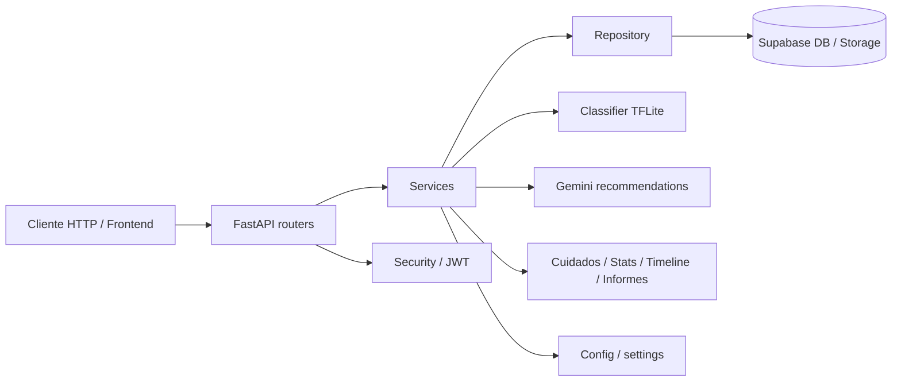
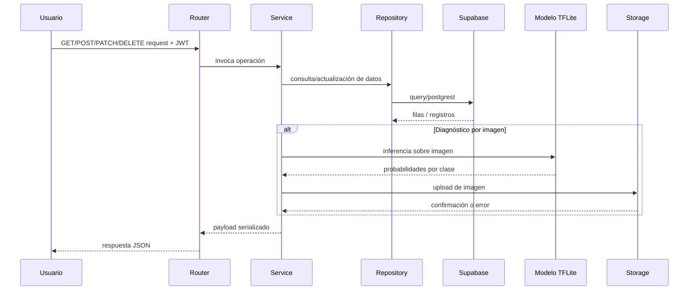
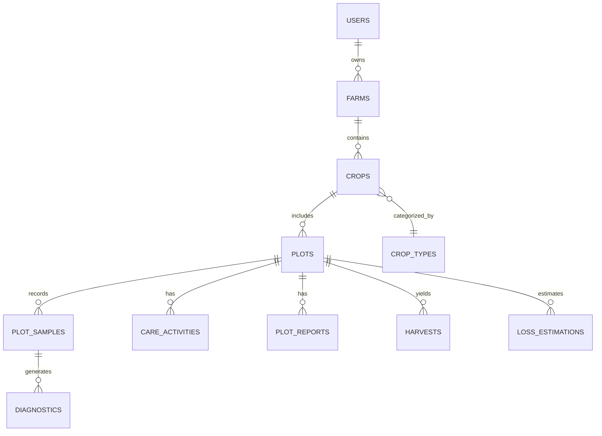

# Proyecto Kroppi API

## 1. Información general

### Nombre del proyecto
Kroppi API

### Propósito y objetivos
El proyecto implementa una API REST en Python para gestionar cultivos, lotes, muestreos y diagnósticos de plantas de café. Su objetivo principal es permitir que un usuario autenticado registre fincas, cultivos y parcelas, capture muestreos visuales y reciba diagnósticos automatizados de enfermedades basados en imágenes.

La aplicación integra:
- autenticación con Supabase Auth/JWT,
- almacenamiento de imágenes en Supabase Storage,
- modelado de predicción para enfermedades del café usando TensorFlow Lite,
- recomendaciones generadas con Gemini cuando la clave de API está configurada,
- módulos de lote: registro de cuidados agrícolas con evidencia fotográfica, estadísticas, línea de tiempo e informes PDF por lote.

### Problema que busca resolver
El proyecto resuelve la necesidad de automatizar la detección temprana de enfermedades en hojas de café a partir de imágenes, integrando el flujo completo entre captura, validación, almacenamiento y análisis de imágenes dentro de una API operativa para productores o técnicos.

### Descripción general de funcionamiento
La API ofrece un conjunto de endpoints protegidos por autenticación. Un usuario accede con un JWT de Supabase, crea cultivos y lotes, registra muestreos y envía imágenes de hojas para diagnósticos. El sistema valida la imagen, determina si el cultivo es compatible con el modelo, ejecuta la inferencia con un modelo TFLite y almacena el resultado junto con las recomendaciones y la URL firmada de la imagen generada por Supabase Storage.

### Alcance actual del desarrollo
El alcance implementado cubre principalmente:
- autenticación y autorización por JWT,
- catálogo de tipos de cultivo,
- gestión de cultivos, lotes, muestreos y diagnósticos,
- diagnóstico por imagen con modelo local,
- almacenamiento de imágenes y firma de URLs temporales,
- actividades de cuidado por lote (CRUD) con evidencia en imagen,
- estadísticas agregadas, línea de tiempo y datos/archivo de informes PDF por lote,
- cosechas y estimaciones de pérdida con CRUD completo,
- integración con Supabase para persistencia y storage.

El repositorio contiene un backend API orientado a servicio y una suite de pruebas automatizadas para la lógica de cosechas, pérdidas y validaciones de negocio. No hay frontend en este repositorio, pero la capa de servicios y rutas HTTP ya incluye el módulo de gestión económica del lote.

---

## 2. Stack tecnológico

### Lenguajes de programación
- Python 3.x

### Frameworks y librerías principales
| Componente | Versión identificada | Propósito |
|---|---:|---|
| FastAPI | 0.162.0 | API REST, validación de request/response, dependencias de seguridad |
| Starlette | 1.10.0 | Base ASGI usada por FastAPI |
| Uvicorn | 0.54.0 | Servidor ASGI para ejecutar la aplicación |
| Pydantic | 2.14.2 | Validación y serialización de modelos |
| httpx | 0.28.1 | Llamadas HTTP asíncronas a Supabase y otras integraciones |
| Supabase Python Client | 2.33.0 | Acceso a base de datos y storage de Supabase |
| PyJWT | 2.15.1 | Validación y decodificación de JWT |
| numpy | 2.5.4 | Procesamiento de arrays de predicción del modelo |
| Pillow | 13.0.0 | Preprocesado de imágenes |
| python-dotenv | 1.2.4 | Carga de variables de entorno desde `.env` |
| zoneinfo (stdlib) | n/a | Zona horaria `America/Bogota` en cuidados, estadísticas, línea de tiempo e informes |
| google-genai | no figura en `requirements.txt`, pero está instalado en `.venv` (2.33.0) y se usa en `app/services/recommendations.py` | Generación de recomendaciones por Gemini |
| TensorFlow Lite / ai_edge_litert | no listado explícitamente; se intenta importación dinámica | Inferencia del modelo `.tflite` |

### Herramientas de desarrollo y utilidades
- `uvicorn` para ejecución local
- `python-dotenv` para entorno local
- scripts auxiliares de validación como `probar_modelo.py`
- `requirements-dev.txt` con `pytest` para pruebas automatizadas
- `migrations/` para SQL (001/002 heredadas; 003/004 vigentes, ver sección 6)
- `.github/modernize/rearchitecture/artifacts/` con artefactos de análisis de arquitectura (contratos, unidades, stack); son documentación generada, no código de ejecución
- `CREATE_CONTEXT.md` / `UPDATE_CONTEXT.md`: instrucciones para generar y actualizar este documento
- `repomix-output.xml`: volcado del repositorio generado con repomix (puede estar desactualizado respecto al código)
- `tests/`: suite de pruebas automatizadas para cosechas, pérdidas y cálculo de series del lote

### Gestores de paquetes
- `pip` mediante `requirements.txt`
- entorno virtual recomendado con `python -m venv .venv`

### Dependencias principales y propósito
- `fastapi` + `uvicorn`: exposición de endpoints HTTP.
- `supabase`: acceso a tablas y storage.
- `PyJWT`: verificación de JWT emitidos por Supabase Auth.
- `httpx`: subida de archivos y firma de URLs temporales.
- `numpy` + `Pillow`: preparación de imágenes para inferencia.
- `google.genai`: recomendaciones de diagnóstico en lenguaje natural.
- `python-dotenv`: carga de variables de entorno.
- `requirements.txt` también fija dependencias transitivas/auxiliares (`cryptography`, `cffi`, `dotenv==0.9.9`, `opentelemetry-api`, etc.). No incluye `ai_edge_litert`/`tensorflow` ni `google-genai`.

---

## 3. Arquitectura del proyecto

### Patrón arquitectónico identificado
La aplicación sigue una arquitectura de backend en capas, con separación conceptual entre:
1. capa HTTP (`routers`),
2. capa de servicio (`services`),
3. capa de acceso a datos (`repository`),
4. capa de configuración y utilidades (`config`, `core`, `db`, `schemas`).

No hay un framework de inyección de dependencias complejo ni un patrón de clean architecture formal; la estructura es funcional y orientada a dominios agrícolas.

### Organización por capas



### Responsabilidades por módulo

#### `app/main.py`
- punto de entrada de la aplicación FastAPI,
- configura `lifespan` para inicializar `Classifier` y `httpx.AsyncClient`,
- habilita CORS,
- registra los routers (`health`, `crops`, `plots`, `samples`, `diagnoses`, `care`, `harvests`, `losses`, `plot_modules`),
- maneja excepciones del tipo `ReglaNegocio`.

#### `app/routers/`
Definen la API HTTP por dominio:
- `health.py`: `/health`
- `crops.py`: cultivos y tipos de cultivo
- `plots.py`: lotes / parcelas
- `samples.py`: muestreos por lote
- `diagnoses.py`: diagnósticos por imagen
- `care.py`: actividades de cuidado por lote y su evidencia
- `harvests.py`: cosechas del lote con CRUD por fecha, cantidad, precio y moneda
- `losses.py`: estimaciones de pérdida y validación de traslapes de periodos
- `plot_modules.py`: estadísticas, línea de tiempo e informes de un lote

#### `app/services/`
Orquestan la lógica de negocio y flujos de integración:
- `crop_service.py`: CRUD de cultivos
- `plot_service.py`: CRUD de lotes y agregación de diagnósticos recientes
- `sample_service.py`: crear/listar muestreos
- `diagnosis_service.py`: validación de imágenes, predicción, almacenamiento y persistencia
- `classifier.py`: wrapper del modelo TFLite
- `storage.py`: upload/delete/signing de URLs en Storage
- `recommendations.py`: llamadas a Gemini para sugerir recomendaciones
- `formatters.py`: serialización de fechas a ISO
- `care_service.py`: CRUD de cuidados, validación (fecha no futura, cantidad+unidad, código de enfermedad) y evidencia en el bucket `care-evidence`
- `cosecha_service.py`: CRUD de cosechas con validación de fechas, totales por moneda e impacto en estimaciones
- `perdida_service.py`: cálculo, preview, validación de traslape y guardado de estimaciones de pérdida
- `perdidas_calculo.py`: lógica numérica para pérdida esperada, montos, redondeos y mensajes explicativos
- `tiempo.py`: utilidades de fecha y conversión a zona horaria `America/Bogota`
- `stats_service.py`: series de incidencia, evolución de salud, desglose de enfermedades, cosechas, ingresos y pérdidas (máx. 3 años, granularidad `week`/`month`)
- `timeline_service.py`: línea de tiempo paginada (`before`/`next_before`) con eventos `sample`, `diagnosis`, `care`, `harvest`, `loss`, `report`
- `reports_service.py`: datos consolidados para el informe, subida/listado/consulta/borrado de PDFs en el bucket `reports`

#### `app/repository/`
Encapsulan las consultas a Supabase y la lógica de acceso a datos:
- `crop_repository.py`
- `plot_repository.py`
- `sample_repository.py`
- `diagnosis_repository.py`
- `cosecha_perdida_repository.py`: operaciones para `harvests` y `loss_estimations` con validación de pertenencia por lote
- `plot_modules_repository.py`: consultas de cuidados, informes, muestreos/cosechas/pérdidas por rango de fechas, diagnósticos y perfil
- `helpers.py`: utilidades y enriquecimiento de registros

#### `app/core/`
- `security.py`: validación del JWT de usuario y obtención del usuario actual
- `exceptions.py`: `ReglaNegocio` para errores de negocio con status HTTP

#### `app/config/settings.py`
- carga variables de entorno,
- define constantes de configuración,
- mantiene el `MODEL_CONFIG` y enfermedades soportadas,
- valida la presencia de variables requeridas al importarse.

#### `app/db/session.py`
- crea el cliente de Supabase con `create_client`.

#### `app/models/__init__.py`
- `TypedDict` que describen filas del esquema (`CropType`, `Crop`, `Plot`, `PlotSample`, `Diagnosis`, `Farm`, `Profile`, `User`, `Harvest`, `LossEstimation`). No incluye todos los tipos de módulos recientes (`care_activities`, `plot_reports`, etc.) pero se mantienen para compatibilidad.

#### `app/schemas/`
- Define DTOs y helpers serializadores, especialmente `fecha_iso`, `diagnostico_json`.
- `cuidado.py` (`CuidadoCrear`, `CuidadoPatch`, tipos de actividad/unidad/método) y `modulos_lote.py` (`InformePeriodo`, `Granularidad`, `TipoEvento`) soportan los módulos de lote.
- `cosecha.py` y `estimacion_perdida.py` modelan las operaciones CRUD de cosechas y pérdidas; `finca.py`, `perfil.py`, `usuario.py` y otros DTOs existen para el esquema de dominio y validación del backend.
- El proyecto usa Pydantic para validación de request/response.

### Principios de diseño identificables
- separación por dominio funcional,
- acceso a datos centralizado en repositories,
- validación de negocio mediante excepciones `ReglaNegocio`,
- uso de dependencias de FastAPI para seguridad,
- uso de singleton del clasificador y cliente HTTP en `app.state` durante el ciclo de vida.

---

## 4. Estructura del repositorio

### Árbol de directorios relevante

```text
kroppi_backend/
├── README.md
├── CREATE_CONTEXT.md
├── UPDATE_CONTEXT.md
├── PROJECT_CONTEXT.md
├── repomix-output.xml
├── requirements.txt
├── probar_modelo.py
├── .github/modernize/rearchitecture/artifacts/   (architecture_index.md, unit_graph.yaml, wire_contracts.yaml, units/*, ...)
├── model_files/
│   ├── kroppi_cafe_v2.tflite
│   └── kroppi_config.json
├── migrations/
│   ├── 001_seed_catalogo.sql
│   ├── 002_storage_y_politicas.sql
│   ├── 003_modulos_lote.sql
│   └── 004_validar_area_lotes.sql
├── pruebas/
│   ├── roya1.jpg
│   ├── roya2.jpg
│   ├── roya3.jpg
│   ├── sana1.jpg
│   ├── sana2.jpg
│   └── sana3.jpg
├── app/
│   ├── __init__.py
│   ├── main.py
│   ├── config/
│   │   ├── __init__.py
│   │   └── settings.py
│   ├── core/
│   │   ├── __init__.py
│   │   ├── exceptions.py
│   │   └── security.py
│   ├── db/
│   │   ├── __init__.py
│   │   └── session.py
│   ├── models/
│   │   └── __init__.py
│   ├── repository/
│   │   ├── __init__.py
│   │   ├── crop_repository.py
│   │   ├── diagnosis_repository.py
│   │   ├── helpers.py
│   │   ├── plot_modules_repository.py
│   │   ├── plot_repository.py
│   │   └── sample_repository.py
│   ├── routers/
│   │   ├── __init__.py
│   │   ├── care.py
│   │   ├── crops.py
│   │   ├── diagnoses.py
│   │   ├── health.py
│   │   ├── plot_modules.py
│   │   ├── plots.py
│   │   └── samples.py
│   ├── schemas/
│   │   ├── __init__.py
│   │   ├── base.py
│   │   ├── cosecha.py
│   │   ├── cuidado.py
│   │   ├── cultivo.py
│   │   ├── diagnostico.py
│   │   ├── estimacion_perdida.py
│   │   ├── finca.py
│   │   ├── lote.py
│   │   ├── modulos_lote.py
│   │   ├── muestreo.py
│   │   ├── perfil.py
│   │   ├── tipo_cultivo.py
│   │   └── usuario.py
│   └── services/
│       ├── __init__.py
│       ├── care_service.py
│       ├── classifier.py
│       ├── crop_service.py
│       ├── diagnosis_service.py
│       ├── formatters.py
│       ├── plot_service.py
│       ├── recommendations.py
│       ├── reports_service.py
│       ├── sample_service.py
│       ├── stats_service.py
│       ├── storage.py
│       └── timeline_service.py
└── .env (no incluido en el repo y requerido para ejecución local)
```

### Descripción de carpetas principales
- `app/`: núcleo de la aplicación.
- `app/config/`: variables de entorno, catálogo de enfermedades y modelo.
- `app/core/`: seguridad y excepciones.
- `app/db/`: cliente a Supabase.
- `app/repository/`: acceso a base de datos.
- `app/routers/`: endpoints HTTP.
- `app/services/`: lógica de negocio, almacenamiento, inferencia y recomendaciones.
- `app/schemas/`: validación y serialización.
- `model_files/`: artefactos del modelo y configuración.
- `migrations/`: scripts SQL (001/002 heredados; 003 crea cuidados/informes/buckets; 004 valida áreas).
- `.github/modernize/`: artefactos de análisis arquitectónico (documentación auxiliar).
- `pruebas/`: imágenes de ejemplo para validación manual del modelo.

### Puntos de entrada
- `app/main.py` es el punto de entrada principal para la API.
- `probar_modelo.py` es un punto de entrada de diagnóstico del modelo sin depender de la base de datos ni de la API.

### Archivos de configuración relevantes
- `requirements.txt`: dependencias del backend.
- `.env`: no está en el repo y debe configurarse localmente; contiene variables de entorno requeridas.
- `app/config/settings.py`: configuración centralizada del sistema.

---

## 5. Funcionamiento interno

### Flujo principal de ejecución



### Procesamiento de información
- Cada endpoint usa `Depends(usuario_actual)` para validar el usuario autenticado.
- Las operaciones de negocio se dirigen a los services y luego a los repositories.
- Los repositories usan `supabase_client.table(...).select(...)/insert(...)/update(...)`.
- Las respuestas JSON suelen serializar fechas mediante funciones de `app/services/formatters.py` y `app/schemas/__init__.py`.

### Validaciones y manejo de errores
- `app/core/exceptions.py` define `ReglaNegocio`, usada para errores de negocio con status HTTP específicos.
- `app/main.py` registra un handler para `ReglaNegocio` y responde con `detail` y `status_code`.
- Se validan:
  - existencia del usuario y permisos,
  - cultivo activo/inactivo,
  - lotes y cultivos válidos,
  - fechas de siembra y cosecha estimada,
  - que `plants_affected <= plants_evaluated`,
  - formato y tamaño de imagen,
  - latitud/longitud como par obligatorio o nulo,
  - cuidados: fecha de aplicación no futura (zona `America/Bogota`), cantidad y unidad enviadas juntas, `target_disease_code` debe existir en `ENFERMEDADES` y no ser `cafe_sano`, imagen de evidencia JPG/PNG/WEBP ≤ 10 MB cuyo MIME coincida con el contenido,
  - estadísticas: `from <= to` y periodo máximo de 3 años; línea de tiempo: tipos de evento válidos y `from <= to`,
  - informes: PDF válido (`application/pdf` con cabecera `%PDF`) ≤ 15 MB y `period_from <= period_to`.

### Estado compartido
- El estado de la aplicación se guarda en `app.state` durante el `lifespan` de FastAPI:
  - `app.state.classifier`
  - `app.state.http`
- El clasificador se crea una vez al arrancar la API y se reutiliza en todas las solicitudes.
- No se observa un manejo explícito de estado de sesión en memoria extra; la persistencia principal está en Supabase.

### Servicios y lógica de negocio
- `diagnosis_service.py` integra validación de imagen, contexto del muestreo, predicción del modelo y almacenamiento persistente.
- `storage.py` realiza upload/delete/signing de URLs en Supabase Storage.
- `recommendations.py` intenta generar sugerencias con Gemini, y si no hay clave configurada devuelve recomendaciones vacías sin romper el diagnóstico.
- `classifier.py` prepara la imagen para TensorFlow Lite y ejecuta la inferencia con un lock de hilo para proteger el intérprete.
- `care_service.py`: verifica propiedad del lote, valida y guarda cuidados; al subir evidencia sube a `care-evidence`, actualiza `evidence_path` (con limpieza del objeto si falla el registro) y borra la evidencia reemplazada. Las URLs de evidencia se firman al responder (502 si falla la firma).
- `stats_service.py` / `timeline_service.py` / `reports_service.py` consultan en paralelo (`asyncio.gather` + threadpool) muestreos, cosechas, pérdidas, cuidados y diagnósticos de un lote. El estado de incidencia se clasifica con los umbrales del tipo de cultivo (`sano`/`alerta`/`peligro`). La enfermedad de un diagnóstico se toma de `predicted_label`, `ai_prediction.disease_code` o, si falta, del top-1 con confianza ≥ `umbral` del modelo.
- `reports_service.py`: `GET report-data` arma el contenido del informe (identificación, muestras, fotos firmadas, cuidados, cosechas, pérdidas, conclusiones con aviso de resultados orientativos); `POST reports` recibe el PDF ya generado por el cliente, lo guarda en `reports/{user_id}/{plot_id}/{report_id}.pdf` y registra un resumen en `plot_reports`. El PDF no se genera en el backend.

---

## 6. Base de datos y persistencia

### Motor de base de datos
El proyecto usa Supabase como backend de persistencia, con PostgREST y la biblioteca `supabase` del cliente de Python. No se usa PostgreSQL directo ni una ORM tradicional en este repositorio.

### Entidades y tablas identificadas
La aplicación hace referencia a estas tablas en código:

| Tabla / entidad | Uso principal |
|---|---|
| `farms` | fincas o propiedades del usuario |
| `crop_types` | catálogo de tipos de cultivo |
| `crops` | cultivos asociados a una finca |
| `plots` | lotes / parcelas dentro de un cultivo |
| `plot_samples` | muestreos de incidencias por parcela |
| `diagnostics` | registros de diagnósticos e imágenes |
| `care_activities` | actividades de cuidado por lote (tipo, producto, cantidad, método, costo, evidencia) |
| `plot_reports` | informes PDF por lote (periodo, ruta de archivo, tamaño, resumen JSON) |
| `harvests` | cosechas por lote; se gestionan con CRUD por fecha, cantidad, valor y moneda |
| `loss_estimations` | estimaciones de pérdida por lote; se calculan, validan y editan con preview + guardado |
| `profiles` / `users` | perfil de usuario y autenticación |

### Relaciones identificadas



Relaciones observadas en código:
- `farms.owner_id` -> `users.id`
- `crops.farm_id` -> `farms.id`
- `crops.crop_type_id` -> `crop_types.id`
- `plots.crop_id` -> `crops.id`
- `plot_samples.plot_id` -> `plots.id`
- `diagnostics.plot_samples_id` -> `plot_samples.id`
- `care_activities.plot_id` / `plot_reports.plot_id` -> `plots.id` (`on delete cascade`); `created_by` -> `profiles.id`
- `harvests` y `loss_estimations` se filtran por `plot_id` (según las consultas del repositorio)

### Operaciones de lectura y escritura
Las consultas se ejecutan a través de `supabase_client.table(...).select(...)`, `insert(...)`, `update(...)`, `eq(...)`, `limit(...)`, `in_(...)` y `order(...)`.

Algunos ejemplos concretos:
- `crop_repository.py`: listar tipos, crear cultivos, listar cultivos por finca, actualizar y archivar.
- `plot_repository.py`: crear lotes, listar lotes, obtener lote con muestra reciente, actualizar coordenadas.
- `sample_repository.py`: registrar muestreos y actualizar `plots.status`.
- `diagnosis_repository.py`: obtener diagnóstico por contexto de muestra, listar diagnósticos, guardar diagnóstico.
- `plot_modules_repository.py`: CRUD de `care_activities`, crear/listar/borrar `plot_reports`, lecturas por rango de fechas de `plot_samples`, `harvests`, `loss_estimations`, `diagnostics`, y consulta de `profiles`.

### Migraciones y configuración
- `migrations/001_seed_catalogo.sql`
- `migrations/002_storage_y_politicas.sql`
- `migrations/003_modulos_lote.sql`: crea `care_activities` y `plot_reports` (checks de dominio, índices por lote/fecha, trigger `updated_at`), habilita RLS con políticas por propietario (lote → cultivo → finca → `owner_id = auth.uid()`), crea los buckets privados `care-evidence` (10 MB; JPEG/PNG/WEBP) y `reports` (15 MB; PDF) con políticas por carpeta `{user_id}/...`.
- `migrations/004_validar_area_lotes.sql`: triggers `plots_farm_area_limit` y `farms_area_limit` que impiden que la suma de `area_ha` de los lotes supere el área de la finca (error `23514`) y que el área de la finca baje por debajo de lo ocupado.

El README indica que las migraciones 001 y 002 pertenecen a un esquema inicial y no deben aplicarse sobre el esquema actual sin revisión (el README no menciona 003 ni 004). El proyecto ha evolucionado desde un primer diseño base y depende de un esquema Supabase ya existente; 003 y 004 corresponden al esquema actual.

---

## 7. APIs e integraciones

### Endpoints implementados
Con base en `app/routers/` y `README.md`:

| Método | Endpoint | Descripción |
|---|---|---|
| GET | `/health` | estado del servicio y versión del modelo |
| GET | `/crop-types` | catálogo de tipos de cultivo |
| POST | `/crops` | crea un cultivo |
| GET | `/crops` | lista cultivos del usuario |
| GET | `/crops/{crop_id}` | obtiene un cultivo |
| PATCH | `/crops/{crop_id}` | actualiza cultivo |
| DELETE | `/crops/{crop_id}` | archiva cultivo (no elimina físicamente) |
| POST | `/crops/{crop_id}/plots` | crea lote |
| GET | `/crops/{crop_id}/plots` | lista lotes de un cultivo |
| GET | `/plots/{plot_id}` | obtiene lote |
| PATCH | `/plots/{plot_id}` | actualiza lote |
| POST | `/plots/{plot_id}/samples` | crea un muestreo de incidencia |
| GET | `/plots/{plot_id}/samples` | historial de muestreos |
| POST | `/diagnoses` | crea diagnóstico a partir de imagen |
| GET | `/diagnoses` | lista diagnósticos |
| GET | `/diagnoses/{diagnostico_id}` | detalle de diagnóstico |
| POST | `/plots/{plot_id}/care-activities` | crea actividad de cuidado |
| GET | `/plots/{plot_id}/care-activities` | lista cuidados (filtros `from`, `to`, `type`, `limit` 1-200, `offset`) |
| GET | `/care-activities/{activity_id}` | detalle de cuidado con URL firmada de evidencia |
| PATCH | `/care-activities/{activity_id}` | actualiza cuidado |
| DELETE | `/care-activities/{activity_id}` | elimina cuidado y su evidencia (204) |
| PUT | `/care-activities/{activity_id}/evidence` | sube/reemplaza evidencia (multipart `file`) |
| DELETE | `/care-activities/{activity_id}/evidence` | elimina la evidencia (204) |
| GET | `/plots/{plot_id}/stats` | estadísticas (`from`, `to`, `granularity` = `week` o `month`; por defecto últimos ~6 meses) |
| GET | `/plots/{plot_id}/timeline` | línea de tiempo (`from`, `to`, `types`, `limit` 1-200, `before`) |
| GET | `/plots/{plot_id}/report-data` | datos consolidados para el informe (`from`, `to` obligatorios) |
| POST | `/plots/{plot_id}/reports` | registra un informe PDF (multipart `period_from`, `period_to`, `file`) |
| GET | `/plots/{plot_id}/reports` | lista informes del lote |
| GET | `/reports/{report_id}` | detalle con URL firmada del PDF |
| DELETE | `/reports/{report_id}` | elimina informe y archivo (204) |

### Parámetros y estructuras
- `POST /diagnoses` recibe `multipart/form-data` con:
  - `file`
  - `plot_samples_id`
  - `latitude` (opcional)
  - `longitude` (opcional)
- Los campos `latitude` y `longitude` se validan como par: ambos presentes o ambos ausentes.
- Los endpoints de cuidados reciben JSON (`CuidadoCrear` / `CuidadoPatch`) con `applied_at`, `activity_type` (`FERTILIZATION`, `FUNGICIDE`, `INSECTICIDE`, `HERBICIDE`, `PRUNING`, `WEEDING`, `IRRIGATION`, `CULTURAL_CONTROL`, `OTHER`), y opcionales `product_name`, `active_ingredient`, `quantity` (>0) + `quantity_unit` (`kg`, `g`, `L`, `mL`, `unit`), `application_method`, `target_disease_code`, `cost` (≥0), `notes`.
- Los índices `limit`, `offset`, `archived`, `plot_id` se validan con límites de rango en FastAPI `Query` o `bool`.

### Autenticación y autorización
- La gran mayoría de endpoints exige `Authorization: Bearer <token>`.
- La validación ocurre en `app/core/security.py` con `usuario_actual`.
- El token se valida con el issuer Supabase y, según el algoritmo, con JWKS o con `SUPABASE_JWT_SECRET`.
- Los repositorios y servicios validan la propiedad del usuario comparando `owner_id` y el `user_id` autenticado.

### Integraciones externas
- Supabase Auth: autenticación y validación JWT.
- Supabase Storage: tres buckets — `diagnosticos` (configurable con `SUPABASE_BUCKET`), `care-evidence` y `reports` (nombres fijos en el código) — con URLs firmadas temporales (`SIGNED_URL_SEGUNDOS = 3600`).
- Supabase Database: persistencia de registros estructurados.
- Modelo TFLite local: predicción de enfermedad.
- Gemini (`google.genai`): recomendaciones para productores.

---

## 8. Seguridad

### Autenticación
- Implementada con JWT de Supabase Auth.
- El `HTTPBearer` de FastAPI exige un token en el header Authorization.
- `usuario_actual` devuelve un objeto `Usuario` con `id` y `email`.

### Autorización
- El backend valida que un usuario solo acceda a registros de su propiedad.
- Ejemplos:
  - `crop_repository.py` verifica `farms.owner_id == user_id` antes de consultar cultivos.
  - `diagnosis_repository.py` filtra por `user_id` y el muestreo perteneciente al lote.
- Los módulos de lote (`care`, `plot_modules`) verifican la propiedad con `lote_propietario` (`cargar_lote`) antes de operar; para cuidados e informes se resuelve primero la fila por id y luego se valida la propiedad de su `plot_id`.
- La migración 003 define además RLS y políticas de storage por propietario como defensa en profundidad; el backend usa la service role key, que las omite, por lo que la validación en código es la barrera efectiva.

### Protección de información
- El proyecto evita confiar en `user_id` enviado por el cliente; el usuario real se infiere del JWT verificado.
- Las claves del servicio para Supabase Storage se usan del lado del servidor y no deberían exponerse al frontend.
- El README deja claro que `SUPABASE_SERVICE_ROLE_KEY` debe existir solo en el servidor.

### Variables de entorno relacionadas con seguridad
- `SUPABASE_URL`
- `SUPABASE_SERVICE_ROLE_KEY`
- `SUPABASE_JWT_SECRET` (opcional)
- `GEMINI_API_KEY` (opcional)
- `CORS_ORIGINS` (configurable, aunque el código usa `allow_origin_regex` para reflejar el Origin)

### Validaciones aplicadas
- tipos de imagen permitidos: JPEG, PNG y WEBP,
- tamaño de archivo máximo: 10 MB (`MAX_UPLOAD_MB`) en diagnósticos; evidencia de cuidados 10 MB y PDFs de informe 15 MB (límites fijos en el código y en los buckets),
- validación de latitud/longitud,
- restricciones combinadas con `Query(ge=..., le=...)`,
- validación de cuántas plantas afectadas no pueden exceder a las evaluadas.

---

## 9. Instalación y ejecución

### Requisitos previos
- Python 3.x
- acceso a un proyecto Supabase con:
  - URL del proyecto,
  - service role key,
  - buckets para almacenamiento (`diagnosticos`, `care-evidence`, `reports`; los dos últimos se crean con `migrations/003_modulos_lote.sql`),
  - esquema de tablas compatible con la API.
- presencia de `model_files/kroppi_cafe_v2.tflite` y `model_files/kroppi_config.json`

### Instalación de dependencias
```bash
python -m venv .venv
source .venv/bin/activate   # Linux/macOS
# o en Windows: .\.venv\Scripts\Activate.ps1
pip install -r requirements.txt
```

### Variables de entorno necesarias
El README y `app/config/settings.py` requieren lo siguiente:

```env
SUPABASE_URL=https://<project-ref>.supabase.co
SUPABASE_SERVICE_ROLE_KEY=<clave-del-servidor>
SUPABASE_JWT_SECRET=<opcional-si-los-tokens-usan-HS256>
SUPABASE_BUCKET=diagnosticos
GEMINI_API_KEY=<opcional>
GEMINI_MODEL=<opcional>
GEMINI_TIMEOUT=<opcional>
CORS_ORIGINS=<opcional>
```

### Ejecución en desarrollo
```bash
uvicorn app.main:app --reload
```

### Detección del modelo sin depender de la API
```bash
python probar_modelo.py pruebas/sana1.jpg pruebas/roya1.jpg
```

### Ejecución de pruebas
El repositorio sí incluye pruebas automatizadas con `pytest` mediante `requirements-dev.txt` y la suite `tests/`. La ejecución principal es:

```bash
pip install -r requirements-dev.txt
pytest tests
```

Además, el script `probar_modelo.py` sigue siendo útil para verificar el comportamiento del modelo sin depender de la API.

---

## 10. Pruebas y calidad

### Pruebas existentes
Se observan estas evidencias:
- carpeta `pruebas/` con imágenes de hoja sana y con enfermedad,
- script `probar_modelo.py` para verificar el comportamiento del modelo sin depender de la API,
- suite `tests/test_cosecha_perdida.py` con pruebas de cálculo, validaciones de negocio, fechas, estimaciones y avisos,
- doble en memoria de Supabase en `tests/conftest.py` para ejecutar la lógica sin red externa.

### Frameworks de testing
El repositorio usa `pytest` (definido en `requirements-dev.txt`) y la suite principal se ejecuta desde `tests/`.

### Cobertura
La cobertura documentada es parcial y se centra en la lógica de cosechas, pérdidas y cálculos del módulo de lote; no hay evidencia de pruebas de API HTTP ni de integración con Supabase storage.

### Validaciones automáticas
- validación de rutas y parámetros por FastAPI,
- validación del JWT,
- validación de imágenes,
- validación de reglas de negocio en repository/service,
- chequeos sobre `GEMINI_API_KEY` y configuración del modelo,
- pruebas de regresión con `pytest` para los cálculos de cosecha y pérdida.

### Problemas conocidos
- Si faltan variables críticas de entorno, la importación de `app/config/settings.py` falla con `RuntimeError`.
- La API depende fuertemente de Supabase, por lo que la disponibilidad de la base y del storage es un requisito de ejecución.
- El manejo de recomendaciones de Gemini es opcional y, si falla, devuelve un arreglo vacío sin interrumpir el diagnóstico.
- La validación del módulo de lote está bien cubierta para cálculos y reglas, pero aún no se ha ampliado a pruebas end-to-end completas.

---

## 11. Estado actual del proyecto

### Funcionalidades implementadas
- gestión completa de cultivos
- gestión de lotes/parcelas
- registro de muestreos
- diagnóstico por imagen para cultivos soportados
- validación de entradas por JWT
- guardado de diagnósticos y metadatos
- firma temporal de URLs de imagen
- integraciones con Supabase
- cuidados por lote con evidencia fotográfica
- cosechas por lote con validación de fecha y totales por moneda
- estimaciones de pérdida con preview, cálculos, validación de traslape y edición
- estadísticas, línea de tiempo y datos de informe por lote
- almacenamiento y consulta de informes PDF (el PDF lo genera el cliente)
- validación de área de lotes frente a la finca (trigger SQL, migración 004)

### Funcionalidades parcialmente implementadas o dependientes de configuración
- generación de recomendaciones con Gemini: funcional si `GEMINI_API_KEY` está configurada
- soporte de cultivos: restringido a `CULTIVOS_SOPORTADOS = {'cafe'}`
- integración con `Supabase Bucket`: depende de la existencia de `SUPABASE_BUCKET` y del bucket físico en la cuenta de Supabase
- `google-genai` y el runtime TFLite no están en `requirements.txt`; deben instalarse aparte
- la lógica de pérdidas y cosechas sigue siendo específica del dominio del café y depende de la integración con Supabase para persistencia

### Funcionalidades pendientes o no verificadas en este repositorio
- pipelines de CI/CD más completos,
- documentación de despliegue para producción,
- esquema formal de migración para el modelo y tablas actuales,
- soporte de otros cultivos o más modelos,
- observabilidad, métricas y monitoreo más avanzados,
- ampliación de la suite de pruebas para rutas HTTP, storage y diagnóstico end-to-end.

### Limitaciones identificadas
- la API está acoplada a Supabase y a sus nombres de tablas,
- el modelo está fijo a `kroppi_cafe_v2.tflite` y a una configuración específica,
- el backend no es agnóstico del dominio: está pensado para café y no presenta una capa de abstracción de cultivos genérica,
- la lógica de recomendaciones con Gemini es opcional y no esencial para el diagnóstico.

### Deuda técnica identificable
- dependencia de nombres concretos de tablas y consultas en Supabase,
- uso de config estática para catálogo de enfermedades y comportamiento del modelo,
- la suite de tests automatizados cubre la lógica de negocio principal, pero todavía no incluye validación end-to-end de la API ni pruebas de storage,
- ausencia de documentación de despliegue y operación,
- `stats_service`, `timeline_service` y `reports_service` repiten la extracción del código de enfermedad y el cálculo de periodos, y `timeline_service`/`reports_service` usan el helper privado `stats_service._status`,
- los límites de subida de los routers de lote (10 MB / 15 MB) están fijos en el código, separados de `MAX_UPLOAD_MB`,
- `app/models` y `app/schemas` incluyen definiciones sin uso en las rutas actuales.

---

## 12. Guía para futuros desarrolladores y asistentes de IA

### Cómo comenzar a trabajar
1. Revisar `README.md` para entender la intención del producto y la configuración mínima.
2. Leer `app/main.py` para localizar el punto de entrada y los routers registrados.
3. Revisar `app/config/settings.py` para conocer variables de entorno críticas.
4. Ubicar la operación a cambiar por dominio:
   - cultivos: `app/routers/crops.py` + `app/services/crop_service.py` + `app/repository/crop_repository.py`
   - lotes: `app/routers/plots.py` + `app/services/plot_service.py` + `app/repository/plot_repository.py`
   - muestreos: `app/routers/samples.py` + `app/services/sample_service.py` + `app/repository/sample_repository.py`
   - diagnósticos: `app/routers/diagnoses.py` + `app/services/diagnosis_service.py` + `app/repository/diagnosis_repository.py`
   - cuidados: `app/routers/care.py` + `app/services/care_service.py` + `app/repository/plot_modules_repository.py` + `app/schemas/cuidado.py`
   - estadísticas, línea de tiempo e informes: `app/routers/plot_modules.py` + `app/services/{stats,timeline,reports}_service.py` + `app/repository/plot_modules_repository.py`
5. Ejecutar la app con `uvicorn app.main:app --reload` después de definir `.env`.

### Convenciones de código observadas
- separación funcional por dominio,
- nombres de funciones en español,
- uso de `async def` en routers y services,
- uso de `run_in_threadpool` para operaciones que ejecutan trabajo bloqueante o llamadas de repositorio,
- manejo de errores de negocio con `ReglaNegocio` en lugar de `Exception` genéricos,
- serialización y normalización centralizada en `app/helpers`, `app/schemas` y `app/services/formatters.py`.

### Archivos que normalmente requieren cambios
- Nueva funcionalidad de endpoint: `app/routers/*.py`
- Nueva lógica de negocio: `app/services/*.py`
- Nueva operación de base de datos: `app/repository/*.py`
- Nuevas variables o catálogo de modelo: `app/config/settings.py`
- Cambios de serialización: `app/schemas/__init__.py` y `app/services/formatters.py`

### Consideraciones importantes
- no asumir que una consulta se puede ejecutar sin Supabase activo,
- no modificar los nombres de las tablas sin revisar todo el repositorio y el esquema actual,
- al tocar diagnósticos, revisar `app/services/storage.py` y `app/services/classifier.py`,
- al tocar JWT/autenticación, revisar `app/core/security.py` y la forma en que se validan permisos por `owner_id`,
- los módulos de lote usan la zona horaria `America/Bogota` para fechas y rangos; mantener esa convención,
- al tocar cuidados/informes, revisar `migrations/003_modulos_lote.sql` (checks, RLS, buckets) y mantener sincronizados los enums de `app/schemas/cuidado.py`,
- `plots.area_ha` está limitado por el área de la finca mediante triggers SQL (migración 004); los errores `23514` provienen de la base de datos,
- al cambiar el modelo, revisar `model_files/kroppi_config.json` y la forma en que se interpreta la salida del clasificador.

---

## Conclusión

El repositorio corresponde a un backend FastAPI dedicado a la gestión agrícola y al diagnóstico de enfermedades del café mediante visión artificial. Su núcleo está en la integración entre Supabase (persistencia y storage), una API autenticada y un modelo TFLite para clasificación de imágenes. La aplicación se encuentra en un estado funcional para su dominio principal, pero con limitaciones claras en cuanto a cobertura de pruebas, despliegue y documentación operativa.

La información aquí documentada se basa en el análisis del código fuente actual y en los artefactos y rutas explícitos del proyecto. Los puntos que no pueden verificarse con certeza se indican como tales.

---

## Historial de actualizaciones

### 2026-11-07
**Resumen:** sincronización del documento con el estado real del repositorio: los módulos de cosechas y estimaciones de pérdida ya tienen rutas y lógica de negocio implementadas, y la base de pruebas automatizadas con `pytest` ya está presente en `tests/`.

**Nuevos componentes documentados**
- Routers `harvests.py` y `losses.py` con CRUD de cosechas y estimaciones de pérdida.
- Servicios `cosecha_service.py`, `perdida_service.py`, `perdidas_calculo.py` y `tiempo.py`.
- Repositorio `cosecha_perdida_repository.py` para acceso a `harvests` y `loss_estimations`.
- Esquemas `cosecha.py` y `estimacion_perdida.py` para validación del módulo económico del lote.
- Suite `tests/test_cosecha_perdida.py` + `tests/conftest.py` con doble de Supabase en memoria.
- Dependencia `pytest` en `requirements-dev.txt`.

**Componentes modificados / corregidos**
- Se actualiza la lista de routers registrados en `app/main.py` para incluir `harvests` y `losses`.
- Se corrige la descripción del alcance del proyecto: cosechas y pérdidas ya tienen CRUD, no solo lectura para reportes.
- Se reemplaza la referencia a ausencia de pruebas automatizadas por la realidad actual del repositorio.
- Se ajusta la sección de deuda técnica para reflejar que la lógica principal ya está cubierta por pruebas, aunque faltan pruebas de API/storage end-to-end.

**Eliminados:** ninguno.

**Secciones afectadas:** 1, 2, 3, 4, 5, 8, 9, 10, 11 y 12. La sección final de conclusión también se mantiene, pero con la información actualizada del repositorio.
